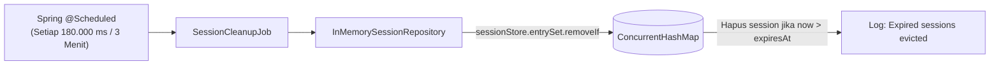

# Arsitektur & Spesifikasi Proyek: ConcurrentHashMap Session Management

Dokumentasi ini dibuat sebagai referensi teknis permanen bagi developer mana pun yang mengembangkan atau memelihara proyek ini di masa depan.

---

## 1. Ringkasan Eksekutif & Tujuan Proyek

Proyek ini adalah backend service berbasis **Java 21**, **Spring Boot 3+**, **Maven**, dan **Project Lombok** yang mengelola session di memori (*in-memory*) menggunakan **`ConcurrentHashMap`** tanpa ketergantungan pada database eksternal.

### Karakteristik Utama:
- **Tahan Konkurensi Tinggi**: Menggunakan `ConcurrentHashMap` dengan operasi thread-safe untuk menangani banyak request registrasi dan pembacaan secara simultan.
- **SHA-256 Session Key Unik**: Formula hash dihitung dari `{clientId}:{agentId}:{pov}:{source};mysession;{timestamp-create};{timestamp-expired}` sehingga pemanggilan berulang dengan data yang sama tetap menghasilkan hash unik dan tidak saling menimpa.
- **TTL Session 1 Jam**: Setiap session memiliki masa aktif 1 jam sejak dibuat.
- **Pembersihan Otomatis Setiap 3 Menit**: Spring `@Scheduled` background job secara periodik membuang key session yang telah expired.
- **Validasi Header `x-session` Menggunakan HTTP 400 Bad Request**:
  - Jika header tidak dikirim atau hash invalid/expired, API mengembalikan **HTTP 400 Bad Request**.
  - *Catatan Arsitektur*: HTTP 401 Unauthorized sengaja tidak dipakai di sini karena dicadangkan khusus untuk validasi token JWT di masa depan.
- **Isolasi State dengan `@RequestScope`**: Setiap panggilan API bisnis (`/customer/**`) mengikat data session ke bean Spring ber-scope Request (`UserSessionContext`), menjamin data per request terisolasi secara aman.
- **Swagger / OpenAPI 3**: Dilengkapi antarmuka Swagger UI interaktif yang dapat dibuka secara bebas tanpa memerlukan header `x-session`.
- **Azure Ready**: Konfigurasi berbasis `application.properties` yang kompatibel dengan Azure Key Vault (AKV) dan Azure App Service Configuration.

---

## 2. Diagram Alur Sistem

### 2.1 Alur Registrasi & Konsumsi API

```mermaid
sequenceDiagram
    autonumber
    actor Client
    participant Swagger as Swagger UI / Client
    participant Interceptor as SessionAuthInterceptor
    participant Storage as InMemorySessionRepository (ConcurrentHashMap)
    participant Scope as @RequestScope UserSessionContext
    participant Controller as CustomerController

    Note over Client, Storage: 1. Registrasi Session (Bebas Header)
    Client->>Storage: POST /session/register { clientId, agentId, pov, source }
    Note right of Storage: Hash SHA-256 dari:<br/>payload + ;mysession;create;expire<br/>Set TTL = now + 1 Jam<br/>Simpan di ConcurrentHashMap
    Storage-->>Client: 201 Created { sessionHash, message, expiresAt }

    Note over Swagger, Controller: 2. Buka Dokumentasi Swagger (Bebas Header)
    Client->>Swagger: GET /swagger-ui.html atau /v3/api-docs
    Note right of Swagger: Dilewati langsung oleh Interceptor (Whitelist)
    Swagger-->>Client: 200 OK (Swagger UI siap digunakan)

    Note over Client, Controller: 3. Panggilan API Bisnis Terproteksi
    Client->>Interceptor: GET /customer/profile [Header: x-session: <sha256>]
    Interceptor->>Storage: findByHash(hash)
    alt Header kosong, hash tidak ditemukan, atau expired (> 1 Jam)
        Storage-->>Interceptor: Optional.empty()
        Interceptor-->>Client: 400 Bad Request { "error": "Header x-session missing, invalid, or expired" }
    else Hash valid & aktif
        Storage-->>Interceptor: UserSession data
        Interceptor->>Scope: Set sessionData & generate requestId
        Interceptor->>Controller: Lanjutkan eksekusi handler
        Controller->>Scope: Ambil sessionData
        Controller-->>Client: 200 OK { profile, sessionInfo, scopeInstanceId }
    end
```

### 2.2 Alur Pembersihan Session Expired (3 Menit Job)



---

## 3. Detail Arsitektur & Komponen

### 3.1 Penyimpanan `sessionStore` (`InMemorySessionRepository`)
- **Lokasi**: Paket `com.example.sessionmap.repository`.
- **Lifecycle**: Spring Singleton Bean (`@Repository`).
- **Data Structure**: `ConcurrentMap<String, UserSession> sessionStore = new ConcurrentHashMap<>()`.
- **Fitur Utama**:
  - `save(String hash, UserSession session)`: Menyimpan data baru.
  - `findByHash(String hash)`: Pencarian dengan **Lazy Expiration Check**. Jika session sudah lewat dari 1 jam saat diakses, data langsung dihapus dan dianggap tidak ada (`Optional.empty()`), mengembalikan HTTP 400 ke client.
  - `removeExpiredSessions()`: Dipanggil oleh background scheduler setiap 3 menit menggunakan `entrySet().removeIf(...)`.
    - **Logging Detail Metrik Hash**: Mencatat log `INFO` berisi: (1) Jumlah hash awal sebelum clear, (2) Jumlah data terhapus karena expired (jumlah terclear), dan (3) Jumlah hash setelah clear selesai. Contoh:
      `[Session Cleanup] Pembersihan selesai. Jumlah hash awal: 50, Jumlah data terhapus karena expired (terclear): 12, Jumlah hash setelah clear: 38`

### 3.2 Penanganan Error Header (HTTP 400 Bad Request)
- Exception: `InvalidSessionException`.
- Status Code: **400 Bad Request** (bukan 401, karena 401 dicadangkan untuk validasi JWT).
- Response JSON:
  ```json
  {
    "status": 400,
    "error": "BAD_REQUEST",
    "message": "Header 'x-session' is missing, invalid, or expired",
    "timestamp": "2026-10-16T13:30:00Z"
  }
  ```

### 3.3 Isolasi State dengan `@RequestScope` (`UserSessionContext`)
- **Lokasi**: Paket `com.example.sessionmap.context`.
- **Lifecycle**: `@Component` + `@RequestScope` (menggunakan CGLIB proxy mode).
- **Fungsi**: Menjamin bahwa setiap HTTP request yang masuk memiliki instance konteks tersendiri di memori. Thread worker pada Tomcat yang melayani request berbeda tidak akan pernah saling menimpa atau membocorkan data session.

### 3.4 Mekanisme Routing Interceptor (`WebMvcConfig`)
Interceptor **TIDAK** berjalan untuk semua request secara membabi buta. Spring DispatcherServlet mencocokkan URL:
- **Hanya Diintercept (`addPathPatterns`)**:
  - `/customer/**` (Endpoint bisnis: `/customer/profile`, `/customer/review`)
  - `/session/me` (Informasi session aktif)
- **Dikecualikan Sepenuhnya / Whitelist (`excludePathPatterns`)**:
  - `/session/register` (Registrasi bebas header)
  - `/session/*` (GET `/session/{hash}`)
  - `/swagger-ui/**` & `/swagger-ui.html` (Swagger UI bebas header)
  - `/v3/api-docs/**` (OpenAPI JSON definition)
  - `/error` (Penanganan error internal Spring)
Ketika request menuju URL yang di-exclude, interceptor **di-bypass 100%** tanpa mengecek header `x-session`.

---

## 4. Struktur Proyek & Paket

```
ConcurrentHashMap/
├── pom.xml                                  // Maven dependencies (Spring Web, Validation, Lombok, SpringDoc Swagger)
├── ARCHITECTURE_PLAN.md                     // Dokumen arsitektur ini
├── README.md                                // Panduan cara run & curl
├── src/
│   ├── main/
│   │   ├── java/com/example/sessionmap/
│   │   │   ├── ConcurrentSessionApplication.java    // Main Class & @EnableScheduling
│   │   │   ├── config/
│   │   │   │   ├── OpenApiConfig.java               // Konfigurasi Swagger & Header x-session
│   │   │   │   ├── SessionProperties.java           // @ConfigurationProperties binding
│   │   │   │   └── WebMvcConfig.java                // Registrasi Interceptor & Path Whitelist
│   │   │   ├── context/
│   │   │   │   └── UserSessionContext.java          // @RequestScope Bean
│   │   │   ├── controller/
│   │   │   │   ├── CustomerController.java          // /customer/profile & /customer/review
│   │   │   │   └── SessionController.java           // /session/register, /session/me, /session/{hash}
│   │   │   ├── dto/
│   │   │   │   ├── CustomerProfileResponse.java
│   │   │   │   ├── CustomerReviewResponse.java
│   │   │   │   ├── RegisterSessionRequest.java
│   │   │   │   ├── RegisterSessionResponse.java
│   │   │   │   └── SessionDetailResponse.java
│   │   │   ├── exception/
│   │   │   │   ├── ErrorResponse.java
│   │   │   │   ├── GlobalExceptionHandler.java
│   │   │   │   └── InvalidSessionException.java     // Menghasilkan HTTP 400 Bad Request
│   │   │   ├── interceptor/
│   │   │   │   └── SessionAuthInterceptor.java
│   │   │   ├── model/
│   │   │   │   └── UserSession.java                 // Lombok Model + Expiration Logic
│   │   │   ├── repository/
│   │   │   │   └── InMemorySessionRepository.java   // Letak ConcurrentHashMap
│   │   │   ├── scheduler/
│   │   │   │   └── SessionCleanupJob.java           // Background Job 3 Menit
│   │   │   └── service/
│   │   │       ├── CustomerService.java
│   │   │       └── SessionService.java
│   │   └── resources/
│   │       └── application.properties               // Konfigurasi aplikasi & Azure friendly
│   └── test/
│       └── java/com/example/sessionmap/
│           ├── ConcurrentSessionApplicationTests.java
│           ├── SessionServiceTest.java
│           ├── InMemorySessionRepositoryTest.java
│           └── SessionRequestScopeIntegrationTest.java // Test 5 session & 10 concurrent requests
```

---

## 5. Spesifikasi Unit & Integration Test: 5 Session & 10 Request

File pengujian: `src/test/java/com/example/sessionmap/SessionRequestScopeIntegrationTest.java`

Tujuan pengujian:
1. Mendaftarkan **5 session berbeda** (`POST /session/register`) dengan data unik:
   - Session 1: `{ clientId: "CLIENT-1", agentId: "AGENT-A", pov: "POV-1", source: "WEB" }`
   - Session 2: `{ clientId: "CLIENT-2", agentId: "AGENT-B", pov: "POV-2", source: "APP" }`
   - Session 3: `{ clientId: "CLIENT-3", agentId: "AGENT-C", pov: "POV-3", source: "POS" }`
   - Session 4: `{ clientId: "CLIENT-4", agentId: "AGENT-D", pov: "POV-4", source: "CHAT" }`
   - Session 5: `{ clientId: "CLIENT-5", agentId: "AGENT-E", pov: "POV-5", source: "BOT" }`
2. Masing-masing mendapatkan **SHA-256 session hash yang berbeda**.
3. Menjalankan **10 request simultan** (menggunakan Java 21 Virtual Threads / ExecutorService) memanggil endpoint terproteksi `GET /customer/profile` secara bergantian memakai 5 hash tersebut (setiap session dipanggil minimal 2x).
4. Verifikasi ketat (*Assertions*):
   - **Kesesuaian Data**: Request dengan hash session `N` **harus selalu** mengembalikan `clientId` milik session `N`, tidak pernah tertukar.
   - **Isolasi `@RequestScope`**: Setiap request dari 10 request tersebut menghasilkan `requestId` (UUID) yang unik. Tidak ada 2 request yang berbagi instance `@RequestScope` yang sama.
   - **Status Respon**: Seluruh 10 request mengembalikan status **HTTP 200 OK**.
   - **Simulasi Error 400**: Menambahkan verifikasi jika request ke-11 dikirim tanpa header atau dengan hash acak, respon yang kembali tepat **HTTP 400 Bad Request**.

```java
@SpringBootTest(webEnvironment = SpringBootTest.WebEnvironment.RANDOM_PORT)
class SessionRequestScopeIntegrationTest {

    @Autowired
    private TestRestTemplate restTemplate;

    @Test
    void testFiveSessionsWithTenConcurrentRequests() throws Exception {
        // 1. Register 5 sessions
        List<String> hashes = new ArrayList<>();
        for (int i = 1; i <= 5; i++) {
            RegisterSessionRequest req = RegisterSessionRequest.builder()
                .clientId("CLIENT-" + i)
                .agentId("AGENT-" + i)
                .pov("POV-" + i)
                .source("SOURCE-" + i)
                .build();
            ResponseEntity<RegisterSessionResponse> resp = restTemplate.postForEntity(
                "/session/register", req, RegisterSessionResponse.class);
            assertThat(resp.getStatusCode()).isEqualTo(HttpStatus.CREATED);
            hashes.add(resp.getBody().getSessionHash());
        }

        // 2. Eksekusi 10 request konkuren menggunakan virtual threads Java 21
        int totalRequests = 10;
        ExecutorService executor = Executors.newVirtualThreadPerTaskExecutor();
        CountDownLatch latch = new CountDownLatch(totalRequests);
        List<CustomerProfileResponse> responses = Collections.synchronizedList(new ArrayList<>());
        Set<String> uniqueRequestIds = ConcurrentHashMap.newKeySet();

        for (int i = 0; i < totalRequests; i++) {
            final int sessionIndex = i % 5;
            final String hash = hashes.get(sessionIndex);
            final String expectedClient = "CLIENT-" + (sessionIndex + 1);

            executor.submit(() -> {
                try {
                    HttpHeaders headers = new HttpHeaders();
                    headers.set("x-session", hash);
                    HttpEntity<Void> entity = new HttpEntity<>(headers);

                    ResponseEntity<CustomerProfileResponse> response = restTemplate.exchange(
                        "/customer/profile",
                        HttpMethod.GET,
                        entity,
                        CustomerProfileResponse.class
                    );

                    assertThat(response.getStatusCode()).isEqualTo(HttpStatus.OK);
                    CustomerProfileResponse profile = response.getBody();
                    assertThat(profile).isNotNull();
                    // Pastikan data payload session tidak tertukar
                    assertThat(profile.getClientId()).isEqualTo(expectedClient);
                    // Pastikan requestId per request unik (bukti request scope)
                    uniqueRequestIds.add(profile.getRequestId());
                    responses.add(profile);
                } finally {
                    latch.countDown();
                }
            });
        }

        assertThat(latch.await(10, TimeUnit.SECONDS)).isTrue();
        executor.shutdown();

        // 3. Verifikasi: 10 request sukses, dan memiliki 10 instance request-scope unik
        assertThat(responses).hasSize(10);
        assertThat(uniqueRequestIds).hasSize(10);
    }
}
```

---

## 6. Konfigurasi `application.properties`

```properties
# Server
server.port=8080

# Application
spring.application.name=concurrent-session-service

# Session Configuration
# TTL session: 1 jam
session.ttl-duration=1h
# Interval pembersihan berkala: 3 menit (180.000 ms)
session.cleanup-interval-ms=180000
# Salt/Identifier key session (dapat di-override via Azure Key Vault / App Settings: SESSION_SALT)
session.salt=mysession

# SpringDoc OpenAPI / Swagger Configuration
springdoc.api-docs.path=/v3/api-docs
springdoc.swagger-ui.path=/swagger-ui.html
springdoc.swagger-ui.operationsSorter=method
```

