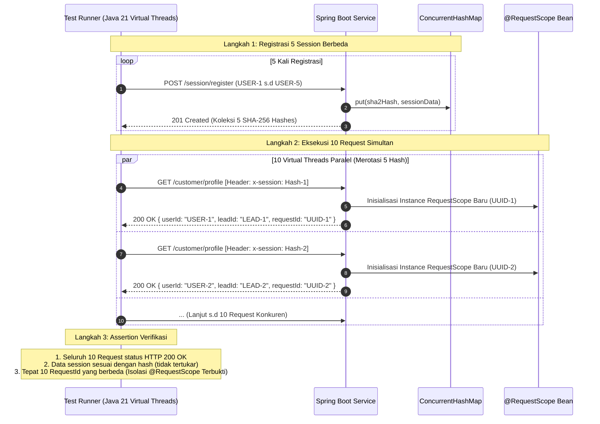

# Rencana Pengujian: ConcurrentHashMap Session Service

Dokumen ini mendefinisikan strategi dan skenario pengujian komprehensif, baik automated test (unit & integration) maupun manual verification.

---

## 1. Automated Tests Matrix

| Komponen Uji | Kelas Pengujian | Deskripsi Skenario | Hasil yang Diharapkan |
|---|---|---|---|
| **Hashing SHA-256** | `SessionServiceTest` | Generate hash dari payload yang sama & payload berbeda | Hash konsisten deterministik, payload beda menghasilkan hash beda |
| **In-Memory Store** | `InMemorySessionRepositoryTest` | Simpan, ambil, dan hitung active session | Data tersimpan aman di `ConcurrentHashMap` |
| **Lazy TTL Expiration** | `InMemorySessionRepositoryTest` | Simpan session dengan TTL buatan (misal 50ms), tunggu 60ms lalu ambil | `findByHash` menghasilkan `Optional.empty()` & key otomatis terhapus dari map |
| **3-Minute Cleanup Job** | `SessionCleanupJobTest` | Panggil method cleanup pada session yang telah expired | Map dibersihkan, memvalidasi perhitungan: hash awal, jumlah terhapus/terclear, dan hash akhir |
| **Validasi Header 400** | `SessionRequestScopeIntegrationTest` | Panggil `/customer/profile` tanpa header atau dengan hash salah | Mengembalikan **HTTP 400 Bad Request** |
| **Whitelist Swagger UI** | `SessionRequestScopeIntegrationTest` | Panggil `/swagger-ui/index.html` dan `/v3/api-docs` tanpa header | Mengembalikan **HTTP 200 OK** |
| **5 Session & 10 Request** | `SessionRequestScopeIntegrationTest` | Registrasi 5 session, panggil 10 request konkuren bergantian | Data tidak tertukar, 10 `requestId` unik per request (@RequestScope) |

---

## 2. Skenario Utama: 5 Session & 10 Request Konkuren

### Diagram Alur Pengujian



---

## 3. Manual Verification Guide

### Langkah 1: Menjalankan Aplikasi
```bash
mvn spring-boot:run
```

### Langkah 2: Menguji Swagger UI
Buka browser di `http://localhost:8080/swagger-ui.html`. Pastikan halaman terbuka langsung tanpa meminta login/header.

### Langkah 3: Registrasi Session via curl
```bash
curl -i -X POST http://localhost:8080/session/register \
  -H "Content-Type: application/json" \
  -d '{"userId":"USR-001","leadId":"LEAD-99","source":"MOBILE_APP"}'
```
Simpan hash yang diperoleh, contoh: `a1b2c3d4...`

### Langkah 4: Memeriksa Payload via Hash Langsung
```bash
curl -i -X GET http://localhost:8080/session/a1b2c3d4...
```

### Langkah 5: Memanggil Endpoint Bisnis
```bash
curl -i -X GET http://localhost:8080/customer/profile \
  -H "x-session: a1b2c3d4..."
```
Perhatikan bahwa response menyertakan `requestId` dan `scopeInstanceHashCode`.

### Langkah 6: Menguji Error 400 Bad Request
```bash
# Tanpa header
curl -i -X GET http://localhost:8080/customer/profile

# Dengan hash acak / salah
curl -i -X GET http://localhost:8080/customer/profile \
  -H "x-session: hash_ngawur_123"
```
Pastikan status yang kembali adalah **HTTP 400 Bad Request**.
